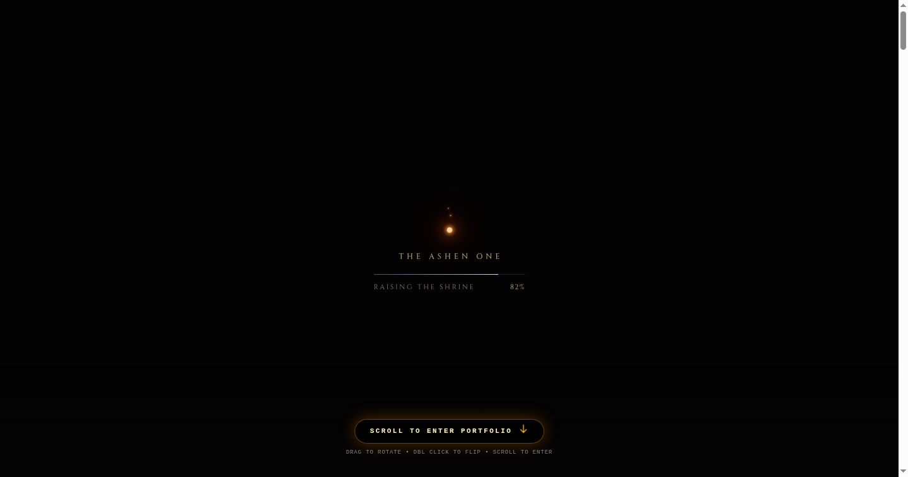
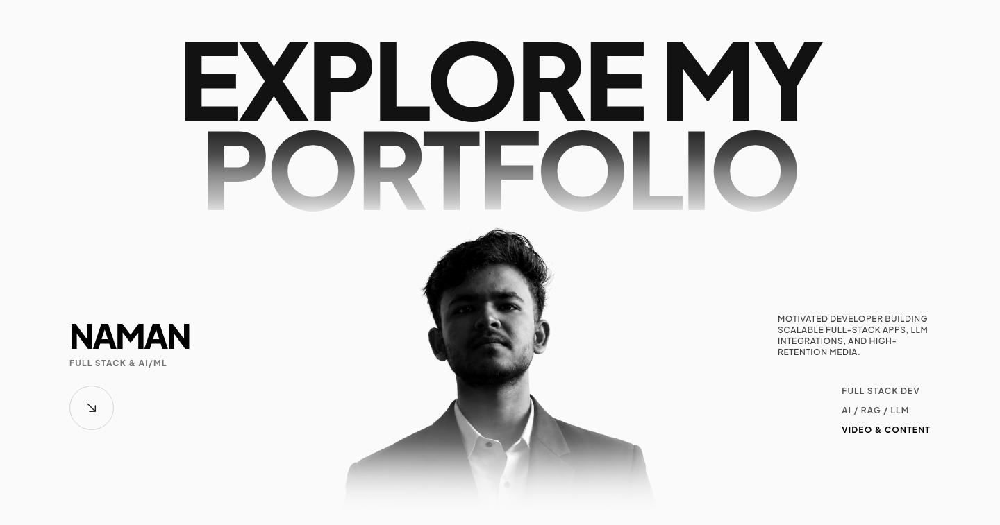
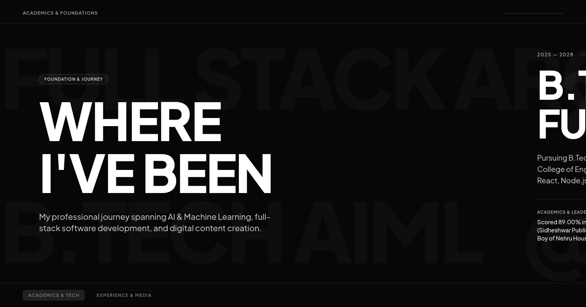
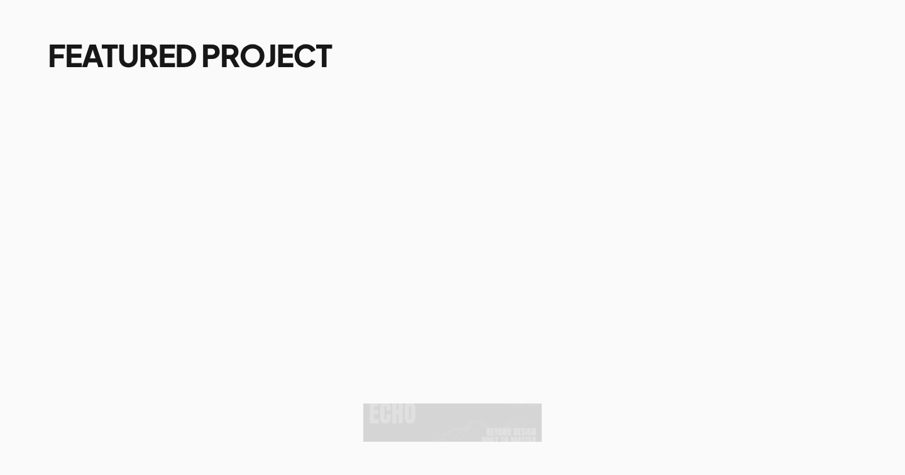

# NAMAN — Full Stack Developer & AI/ML Engineer Portfolio

<div align="center">

  [](https://naman-portfolio-theta.vercel.app)
  [](https://threejs.org/)
  [](https://tailwindcss.com/)
  [](https://github.com/oframe/ogl)
  [](LICENSE)

  <p align="center">
    <strong>A high-end, immersive developer & designer portfolio combining a 3D Three.js Dark Souls holographic card opening experience with a minimalist brutalist editorial aesthetic.</strong>
  </p>

  <p align="center">
    Designed & Engineered by <strong><a href="https://github.com/temp-pie1207">Naman</a></strong><br>
    B.Tech Artificial Intelligence & Machine Learning • Full Stack Developer • Video Creator & Editor
  </p>

  <p align="center">
    <a href="https://naman-portfolio-theta.vercel.app"><strong>Explore Live Website ↗</strong></a> •
    <a href="https://github.com/temp-pie1207/Portfolio_Naman">GitHub Repository</a> •
    <a href="https://www.instagram.com/namanwuv_/">Instagram</a> •
    <a href="https://leetcode.com/u/Naman2109/">LeetCode</a> •
    <a href="mailto:namankashyap484@gmail.com">Contact</a>
  </p>

</div>

---

## ✦ Preview Gallery

<div align="center">

### 1. 3D Dark Souls Holographic Card Stage ("The Ashen One")
*Embedded ThreeUI r180 Three.js runtime featuring custom GLSL shaders, real-time lighting, and 3D sword shrine.*



---

### 2. Editorial Hero Section
*Monochrome aesthetic featuring metallic headline typography, custom portrait depth masking, and fluid navigation.*



---

### 3. Spatial Experience Timeline & Horizontal Canvas
*Sticky spatial timeline translating vertical scroll into horizontal career progression.*



---

### 4. Interactive Projects Showcase & FlexCarousel
*Liquid WebGL mesh distortion slider with real-time accordion physics and deep project inspection.*



</div>

---

## ✦ Key Features & Architecture

### 1. ⚔️ ThreeUI `<DarkSoulsHoloCard />` (Variant: `ashen-one`)
- **Three.js r180 & Custom GLSL**: Full runtime integration with multi-pass post-processing, bloom, volumetric fog, and chromatic holographic shaders.
- **Custom Embedded Portrait**: Authentic portrait of Naman integrated into the holographic card's texture memory (`assets/subject.webp`).
- **Gated Cinematic Intro Sequence**:
  - Embers gather on a dark candlelit stone altar.
  - Altar ambient occlusion and wireframe scan bake in real time.
  - The card rises from the shrine, kindles with golden light, and reveals holographic depth foil.
  - Page scroll is locked until the intro animation completes to guarantee the full cinematic visual experience.
- **Full 3D Interaction Mechanics**:
  - **Drag to Rotate**: 360° rotational physics with momentum inertia.
  - **Double Click to Flip**: Seamlessly flips between front holographic art and back altar inscription.
  - **Mouse Tracking**: Parallax light direction and specular glint sheen.
  - **Forwarded Wheel Events**: Mouse wheel delta is communicated to the parent window via IPC `postMessage`.

### 2. 🌌 Scroll-Driven Opening Animation
- After the 3D card animation completes, scrolling is unlocked and the pulsing prompt **`SCROLL TO ENTER PORTFOLIO ↓`** fades in.
- Any downward scroll gesture triggers an exit animation:
  - The holographic card drifts backward and dissolves with soft optical blur (`blur(10px)` and `scale(0.85)`).
  - The editorial portfolio glides smoothly into focus.
  - Scrolling back to `scrollY === 0` restores the card for continuous 3D inspection.

### 3. 🌊 FlexCarousel (Liquid WebGL Preset)
- Interactive card carousel engine powered by **OGL** WebGL.
- Real-time lens refraction, edge displacement, and liquid spring physics.
- Dynamic accordion states, focus-on-click navigation, and keyboard controls.

### 4. 🧭 Horizontal Spatial Experience Timeline
- Sticky full-viewport canvas that translates vertical user scroll into continuous horizontal timeline motion.
- "Living flow" electric current line animations and responsive fallback for reduced-motion preferences.

### 5. 🎡 WorksWheel 3D Drum Reel
- Mathematical 3D cylindrical drum projection with radial ring transformations (`rotateX`, `rotateZ`, `translateZ`).
- Physics drag gestures, momentum inertia, wheel scrolling, and step buttons.

### 6. 🪟 Interactive Project Inspection Modals
- High-contrast glassmorphic modal with animated backdrop blur (`cubic-bezier` spring easing).
- Comprehensive metadata: client overview, deliverables, tech stacks, and direct links.

---

## ✦ Tech Stack

| Layer | Technologies | Purpose |
|---|---|---|
| **3D & Shaders** | Three.js r180, WebGL, Custom GLSL, ThreeUI | Dark Souls Holo Card, sword shrine, candle flames, scan pulse |
| **Micro-Graphics** | [OGL](https://github.com/oframe/ogl) | Liquid mesh bending in FlexCarousel |
| **Structure** | Semantic HTML5, ES Modules (ESM) | Ultra-lightweight, zero-framework runtime overhead |
| **Styling** | Tailwind CSS v3, Vanilla CSS3 | Custom typography, metallic gradients, responsive clamp |
| **Typography** | Plus Jakarta Sans, Cinzel, EB Garamond | High-end editorial typography |
| **Hosting** | Vercel Edge Network | Global CDN, static deployment, HTTPS |

---

## ✦ Project Structure

```bash
ECHO-WEBSITE/
├── index.html                   # Master single-page portfolio layout & sections
├── dark-souls-holo-card.js       # ThreeUI DarkSoulsHoloCard adapter & opening stage controller
├── threeui.css                  # Shared ThreeUI background & component styling
├── flex-carousel.js             # OGL WebGL liquid carousel engine
├── FlexCarousel.css             # Carousel states & layout rules
├── FlexCarousel.tsx             # React/TypeScript component source
├── works-wheel.js               # 3D cylindrical drum reel component
├── scroll-expand-media.js       # Kinetic scroll expansion media canvas
├── experience-section.js        # Horizontal spatial timeline engine
├── package.json                 # Project configuration & npm scripts
├── vercel.json                  # Vercel static build routing configuration
├── landing-pages/
│   ├── dark-souls-holo-card.html            # The Ashen One canonical Three.js source
│   └── dark-souls-holo-card-cindermane.html # Cindermane variant source
├── src/shaders/
│   └── dark-souls-holo-card/DarkSoulsHoloCard.tsx # ThreeUI React component specification
└── assets/
    ├── naman_holo_subject.webp  # Naman's transparent portrait embedded in 3D card
    ├── naman_hero_portrait.png  # Hero section depth-masked portrait
    ├── preview_holo_card.png    # Preview: 3D Holographic Card
    ├── preview_hero.png         # Preview: Editorial Hero Section
    ├── preview_experience.png   # Preview: Horizontal Spatial Timeline
    └── preview_projects.png     # Preview: Projects Showcase & Carousel
```

---

## ✦ Getting Started Locally

### Prerequisites
- Python 3.x **or** Node.js installed on your machine.

### Clone & Run

```bash
# 1. Clone the repository
git clone https://github.com/temp-pie1207/Portfolio_Naman.git
cd Portfolio_Naman

# 2. Run local HTTP server (Python)
python3 -m http.server 8080

# 3. Alternatively using Node.js / npx:
npx serve .
```

Open your browser and navigate to **`http://localhost:8080`**.

---

## ✦ Deployment

This project is fully static and configured for instant zero-configuration deployment to **Vercel**:

```bash
# Deploy to production via Vercel CLI
npx vercel --prod --yes
```

- **Production URL**: [https://naman-portfolio-theta.vercel.app](https://naman-portfolio-theta.vercel.app)

---

## ✦ About the Author

**Naman**
- 🎓 **Education**: B.Tech in Artificial Intelligence & Machine Learning (2025 – 2028), Dronacharya College of Engineering
- 💼 **Focus**: Full-Stack Development (React, Next.js, Node.js, Python, FastAPI), LLM & RAG Systems, High-Retention Video Production
- 📍 **Location**: Gurgaon, India
- 🌐 **Portfolio**: [naman-portfolio-theta.vercel.app](https://naman-portfolio-theta.vercel.app)
- 🐙 **GitHub**: [@temp-pie1207](https://github.com/temp-pie1207)
- 📁 **Repository**: [temp-pie1207/Portfolio_Naman](https://github.com/temp-pie1207/Portfolio_Naman)
- 📸 **Instagram**: [@namanwuv_](https://www.instagram.com/namanwuv_/)
- 💻 **LeetCode**: [Naman2109](https://leetcode.com/u/Naman2109/)
- ✉️ **Email**: [namankashyap484@gmail.com](mailto:namankashyap484@gmail.com)

---

## ✦ License

This project is open-source and released under the [MIT License](LICENSE).
